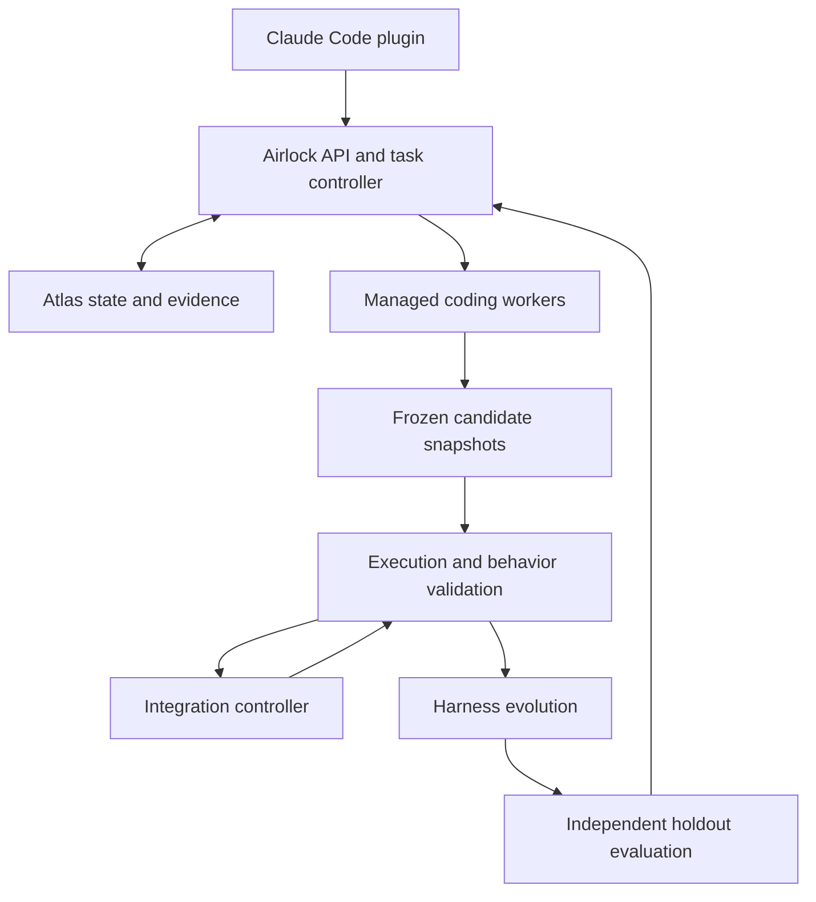

# Airlock Evolve: technical build specification

Prepared for the October 11, 2026 Harness Engineering & Model Wrangling hackathon.

This is a proposed implementation, not a description of an existing product. API paths, collection names, policy fields, and examples below are Airlock contracts unless explicitly identified as Claude Code interfaces. Sample IDs, hashes, measurements, and paths are illustrative.

## 1. Product and implementation decision

Airlock is a controller for delegated coding work. It records task intent, assigns bounded worker environments, evaluates frozen changes, integrates candidates, and validates improvements to its own harness. A passing patch does not imply arbitrary code is safe; verdicts describe the exact scenarios and revision tested.

Build the managed-worker path first:

- A Claude Code plugin supplies `/airlock:run`, hooks, and an MCP bridge.
- The main Claude session proposes the plan and assignments.
- Airlock owns the task DAG and launches separate Claude Code worker sessions through the Claude Agent SDK.
- Each managed worker receives its own checkout and, for execution isolation, a container.
- The controller owns snapshots, tests, integration, policy promotion, and publication.
- MongoDB Atlas Sandbox is the durable authority for state and evidence.

Managed workers are separate SDK-hosted Claude Code sessions, not native `Agent` tool instances in the parent session. Their role is the same delegated coding work. This explicit distinction prevents assuming a native hook can transparently replace Claude's process management.

Native mode is an optional adapter: intercept `PreToolUse` for `Agent`, select an existing custom profile, request worktree isolation, observe lifecycle events, and evaluate snapshots. That mode needs its own integration and ID-correlation adapter. Do not claim that worktrees or hook command matching make native same-host workers a security sandbox.

In managed mode, a denied native `Agent` invocation instructs Claude to call the Airlock MCP delegate tool. Denial does not itself execute or redirect a worker. Read-only native exploration can be allowed, while coding assignments use Airlock.

## 2. Component topology



Implement logical components as one API process plus one job-worker process today. The logical separation identifies authority boundaries; it does not require a fleet of services.

| Component | Implementation | Owns |
|---|---|---|
| Plugin | Manifest, skill, Python hook adapter, MCP bridge | Connection to the parent Claude session |
| API/controller | FastAPI, Pydantic, PyMongo | Task state, delegation authorization, scheduling |
| Job worker | Python process polling Atlas jobs | Execution of durable work items |
| Coding worker host | Claude Agent SDK inside a bounded container | Agent run and tool decisions |
| Checkout manager | Git subprocesses with argument arrays | Exact base revision and independent checkouts |
| Validator | Trusted pytest scenarios and mock services | Application execution and observations |
| Integrator | Controller-owned Git checkout | Serial composition of candidate changes |
| Evolver | SDK session with structured proposal output | Candidate harness configuration and scenario code |
| Holdout evaluator | Fixed trusted suite | Promotion evidence |
| Review surface | CLI plus compact evidence cards | Review of intent, behavior, and policy diffs |

Use Atlas through PyMongo. Keep control-plane data separate from the target application's test database. Do not hand Atlas credentials to application code or coding workers. If using synchronous PyMongo, execute its blocking calls in FastAPI's thread pool or synchronous route handlers, not directly on an async event loop.

## 3. The complete task lifecycle

Example request: "Implement login and sessions: add the database schema, service functions, and API routes."

1. Register the project and capture its starting tree. Require a known baseline; if the user's checkout is dirty, create a controller-owned snapshot of the current files without discarding or committing their edits in their original repository.
2. Create a task. The planner converts the request into constraints, acceptance criteria, assignments, dependencies, and interface contracts.
3. Confirm the task's effect contract through the operator interface. An LLM-generated plan cannot grant new privileges or broaden publication permissions.
4. Schedule ready assignments. Every launch records the exact input snapshot, contract version, harness version, model, and worker identity.
5. Agent A implements the session schema. Freeze its candidate and validate it. Integrate it into the controller's staging branch if it meets that stage's criteria.
6. Agents B and C start from that integrated revision. B implements `login()` and `createSession()`; C implements routes against the agreed signatures. These may run concurrently if their file scopes are independent.
7. Freeze each output. A service-only candidate may need interface stubs for isolated checks; label those checks `partial`, not complete feature validation.
8. Integrate B and C serially into a new candidate revision. Run the complete application suite against the combined revision. Resolve conflicts through a new repair assignment; never silently overwrite another worker's changes.
9. Return precise repair evidence if requirements fail. A repair gets a new attempt and a new snapshot.
10. Run any harness-learning job separately. Evaluate the old and candidate harness on fixed application revisions and held-out tasks before promotion.
11. Produce a verified branch or patch. Publishing to an external remote is a separate controller action, authorized by the operator and bound to the final verified revision.

If A, B, and C all start in parallel from the original base, they must implement against a frozen shared interface contract. Integration is still mandatory. A worktree does not automatically import a sibling's edits or the parent's uncommitted files.

## 4. Worker isolation and snapshot model

The controller has its own repository mirror. It uses worktrees for staging and integration. Each coding container receives an independent checkout/archive produced from the chosen input revision; it does not receive the controller's writable Git metadata. This retains the worktree workflow without exposing a shared `.git` authority to untrusted code.

For the demo, bind these identities at launch:

```json
{
  "task_id": "task_auth_01",
  "delegation_id": "del_service_01",
  "worker_run_id": "worker_service_01",
  "base_artifact_id": "art_schema_integrated",
  "harness_version_id": "hv_001",
  "contract_version": 1,
  "container_workdir": "/repo"
}
```

Only the supervisor can assert this identity. Prompt markers, model-supplied task IDs, and worker reports are not authorization credentials.

At completion:

- Stop the worker and its child processes before reading output files; a final text response alone does not freeze the filesystem.
- Capture tracked, staged, unstaged, and relevant new files using an explicit manifest. Handle deletions, modes, symlinks, and binary changes deliberately. Reject path traversal and paths outside the checkout.
- Compare actual changed files with the assignment's allowed scope. Any scope exception needs a recorded controller decision.
- Store a canonical tree hash and patch hash; commit SHAs additionally identify controller-side Git revisions.
- Use the frozen archive in validation. Do not test a live checkout that the worker can continue changing.
- The trusted evaluator supplies its own scenarios. Candidate modifications to tests cannot remove the independent checks.

Coding containers have no publication credentials, Atlas credentials, host home directory, or Docker socket. The inference credential is a necessary worker secret: preferably supply a short-lived gateway credential, restrict egress to the inference gateway, and do not treat that credential as an application secret. The application validator uses fake credentials and isolated test services.

For today, arbitrary Bash is allowed only inside the bounded coding container. File-path hooks are useful feedback, but they cannot enforce path boundaries if Bash can write arbitrary paths. Read-only research profiles should omit Bash unless a specifically bounded command tool is provided.

## 5. Claude interfaces to use

### Plugin and native hook adapter

| Interface | Use |
|---|---|
| `/airlock:run` skill | Establish an Airlock task and explain the managed flow |
| `PreToolUse` on `ExitPlanMode` | Inspect explicit plan-mode output; retain the normal approval boundary |
| `PreToolUse` on `Agent` | Observe/defer native coding delegation into the managed workflow |
| `SubagentStart` | Native-mode identity/context observation; it cannot veto spawning |
| `SubagentStop` | Native-mode completion observation and repair feedback |
| `PreToolUse` on mutation/publication tools | Prevent accidental bypass in the parent workflow |
| `Stop` | Return task status or repair guidance; do not run a long evolution experiment inside the hook |

Hooks are adapters, not the scheduling engine. `Stop` and `SubagentStop` are turn/lifecycle signals, not proof of task completion. A background `Agent` launch can return before the worker finishes. Never classify launch acknowledgment as a completed candidate.

Plugin-defined subagent frontmatter does not support all fields available to project/user agents; use plugin-level hooks for the plugin integration. Check the installed CLI/SDK version and log a sanitized real hook payload before relying on optional fields. Native child-to-delegation correlation must be explicit: never assign identities by "the most recently launched worker" under concurrency.

### Managed execution

Use Claude Agent SDK `query` or `ClaudeSDKClient` with explicit working directory, model, tools, turn/budget limits, structured output where needed, and controller-owned hooks. Tool inventory and permission preapproval are separate concepts. In particular, don't preapprove a gated tool through `allowed_tools` and expect `can_use_tool` to be invoked for every call. Use documented `PreToolUse` callbacks for per-call policy decisions and validate the installed version's behavior.

Planner output and evolution proposals are schema-constrained data. They never directly update Atlas policy pointers. The controller validates them and runs the appropriate evaluator.

### MCP bridge tools (our proposed tools)

| Tool | Input | Result |
|---|---|---|
| `airlock_plan` | Project ID, request | Draft task and contract |
| `airlock_delegate` | Task ID, assignment ID | Worker run/job IDs |
| `airlock_status` | Task ID | States and sanitized evidence |
| `airlock_integrate` | Task ID, artifact IDs | Integration job ID |

The authenticated actor's scope determines which IDs it can use. Workers do not receive the operator tools for approval, promotion, or publishing.

## 6. HTTP API contracts

All mutating public endpoints require authentication and an `Idempotency-Key`. Validate references against the authenticated project/task scope. Operator, worker-host, runner, and evolver identities have different capabilities. Never accept caller-provided `approved_by` or trust labels. Store write-command receipts in `jobs` using `kind: command_receipt`, a project/actor/operation/key-scoped deduplication key, request digest, and cached result; completed receipts are not executable jobs. Create the receipt and corresponding state mutation in one MongoDB transaction. On a retry with a different request digest, return 409.

| Method and path | Actor | Purpose |
|---|---|---|
| `POST /v1/projects` | Operator | Register one permitted repository and its baseline |
| `POST /v1/tasks` | Operator/parent bridge | Create draft plan and task |
| `POST /v1/tasks/{id}/approve` | Operator | Confirm a specific contract digest/version |
| `GET /v1/tasks/{id}` | Scoped reader | Read task and worker states |
| `POST /v1/tasks/{id}/delegations` | Parent bridge/controller | Create an assignment within approved intent |
| `POST /v1/delegations/{id}/launch` | Controller | Queue a managed worker |
| `POST /v1/hooks/pre-tool-use` | Hook adapter | Fast policy decision; native JSON response |
| `POST /v1/hooks/lifecycle` | Hook adapter | Record lifecycle signal |
| `POST /v1/worker-runs/{id}/finish` | Worker supervisor | Stop/freeze run and queue validation |
| `POST /v1/validation-runs` | Controller | Queue evaluation of immutable artifacts |
| `POST /v1/integration-runs` | Controller | Queue composition and combined validation |
| `POST /v1/evolution-runs` | Controller | Queue candidate harness generation and evaluation |
| `POST /v1/evolution-runs/{id}/promote` | Promotion controller | Promote a passing candidate with version guards |
| `POST /v1/projects/{id}/rollback` | Operator | Point to a previously validated harness version |
| `POST /v1/tasks/{id}/publish` | Operator/publisher | Publish exact verified revision |
| `GET /v1/jobs/{id}` | Scoped reader | Poll durable job result |
| `GET /v1/tasks/{id}/events` | Scoped reader | SSE stream with reconnect cursor |

Long operations return `202 Accepted` with a job ID. Hook policy checks should complete quickly; they don't wait for Docker builds or a full suite. Pending validation is an explicit state, not an implicit pass. On controller failure, block mutating actions in managed tasks and retain unapproved state. Read-only behavior can follow a separately documented degraded-mode policy.

### Create a task

```json
{
  "project_id": "proj_demo",
  "parent_session_id": "claude_parent_01",
  "request": "Implement login and sessions",
  "base_artifact_id": "art_base_01",
  "plan": {
    "constraints": ["No credential material in application logs"],
    "acceptance": ["Valid login creates one session", "Invalid login creates no session"],
    "interface_contract": {
      "sessions_columns": ["id", "user_id", "expires_at"],
      "login_signature": "login(email, password) -> token"
    },
    "assignments": [
      {"key": "schema", "depends_on": [], "file_scope": ["db/migrations/**"]},
      {"key": "service", "depends_on": ["schema"], "file_scope": ["src/auth/service.py"]},
      {"key": "routes", "depends_on": ["schema"], "file_scope": ["src/auth/routes.py"]}
    ]
  }
}
```

Response:

```json
{
  "task_id": "task_auth_01",
  "status": "planned",
  "contract_version": 1,
  "contract_digest": "sha256:contract-example",
  "approval_required": true
}
```

### Launch a delegation

```json
{
  "base_artifact_id": "art_schema_integrated",
  "expected_task_revision": 4
}
```

Response:

```json
{
  "delegation_id": "del_service_01",
  "worker_run_id": "worker_service_01",
  "job_id": "job_launch_service_01",
  "status": "queued",
  "harness_version_id": "hv_001"
}
```

A native hook denial response for a coding delegation in managed mode:

```json
{
  "hookSpecificOutput": {
    "hookEventName": "PreToolUse",
    "permissionDecision": "deny",
    "permissionDecisionReason": "This coding assignment belongs to Airlock task task_auth_01. Submit its approved assignment through airlock_delegate; Airlock owns its execution checkout."
  }
}
```

### Request combined validation

```json
{
  "task_id": "task_auth_01",
  "base_artifact_id": "art_schema_integrated",
  "candidate_artifact_ids": ["art_service_01", "art_routes_01"],
  "expected_task_revision": 9,
  "suite_version_id": "suite_auth_001"
}
```

API errors use `{ "error": { "code": "BASE_MISMATCH", "message": "...", "retryable": false } }`. Use 409 for stale revisions, digest conflicts, and unmet prerequisites; 403 for actor/scope violations; 422 for malformed contracts. Idempotency retries with different payload digests are 409 errors.

## 7. MongoDB data model

Use database `airlock` in the provided Atlas Sandbox. For today, use eleven normal collections. Avoid an extra vector database, graph database, or time-series subsystem. Store relation IDs and query them explicitly; enforce reference integrity in the controller.

Every document has `schema_version: 1`. Store real MongoDB UTC Date values, not timestamp strings; strings below are only readable examples. Use `revision` on mutable state documents for optimistic concurrency. Sanitize traces before persistence. Raw application output is untrusted evidence, even when a trusted runner collected it.

### 7.1 `projects`: repository and active harness pointer

```json
{
  "_id": "proj_demo",
  "schema_version": 1,
  "name": "auth-demo",
  "repository": {"registered_root_id": "repo_demo", "default_branch": "main"},
  "baseline_artifact_id": "art_base_01",
  "active_harness_version_id": "hv_001",
  "harness_generation": 1,
  "constraint_epoch": 1,
  "revision": 1,
  "created_at": "2026-10-11T19:30:00Z"
}
```

`registered_root_id` resolves to a host path known to the controller, not a caller-selected filesystem path. `constraint_epoch` changes on protected-boundary changes or revocation; it invalidates old eligibility decisions.

### 7.2 `tasks`: intent, contract, and final result

```json
{
  "_id": "task_auth_01",
  "schema_version": 1,
  "project_id": "proj_demo",
  "parent_session_id": "claude_parent_01",
  "request": "Implement login and sessions",
  "status": "running",
  "revision": 4,
  "contract_version": 1,
  "contract_digest": "sha256:contract-example",
  "contract": {
    "constraints": ["No credential material in application logs"],
    "acceptance": ["Valid login creates one session", "Invalid login creates no session"],
    "interfaces": {"login": "login(email,password)->token"}
  },
  "approval": {"actor_id": "operator_01", "approved_at": "2026-10-11T19:31:00Z"},
  "base_artifact_id": "art_base_01",
  "delegation_ids": ["del_schema_01", "del_service_01", "del_routes_01"],
  "final_artifact_id": null,
  "final_validation_run_id": null,
  "created_at": "2026-10-11T19:30:00Z"
}
```

Task states: `draft`, `planned`, `approved`, `running`, `awaiting_integration`, `validating`, `repair_required`, `completed`, `failed`, `cancelled`. Completion means verified task output, not necessarily remote publication. Persist publication separately in the task result with exact artifact and actor.

### 7.3 `delegations`: assignment and dependencies

```json
{
  "_id": "del_service_01",
  "schema_version": 1,
  "project_id": "proj_demo",
  "task_id": "task_auth_01",
  "assignment_key": "service",
  "objective": "Implement login and session service functions",
  "depends_on": ["del_schema_01"],
  "file_scope": ["src/auth/service.py"],
  "profile_key": "auth-implementation",
  "status": "running",
  "attempt": 1,
  "revision": 2,
  "resolved_input_artifact_id": "art_schema_integrated",
  "contract_version": 1,
  "active_worker_run_id": "worker_service_01",
  "accepted_artifact_id": null
}
```

Dependencies are satisfied only by controller-accepted integrated outputs, not worker completion messages. Reject cycles. A parent assignment may spawn children only through controller authorization; disable unmanaged nested workers in the demo.

### 7.4 `worker_runs`: execution identity and snapshot lifecycle

```json
{
  "_id": "worker_service_01",
  "schema_version": 1,
  "project_id": "proj_demo",
  "task_id": "task_auth_01",
  "delegation_id": "del_service_01",
  "attempt": 1,
  "status": "running",
  "revision": 1,
  "execution": {"mode": "managed", "host_id": "host_01", "container_id": "container_service_01"},
  "claude_session_id": null,
  "input_artifact_id": "art_schema_integrated",
  "harness_version_id": "hv_001",
  "constraint_epoch": 1,
  "model_requested": "sonnet",
  "context_manifest": ["src/auth/repository.py", "db/migrations/003_sessions.sql"],
  "output_artifact_id": null,
  "budget": {"max_turns": 20, "max_runtime_seconds": 600},
  "started_at": "2026-10-11T19:35:00Z",
  "finished_at": null
}
```

Worker states: `queued`, `starting`, `running`, `stopping`, `snapshotting`, `finished`, `failed`, `cancelled`. `finished` means output frozen, not accepted. Supervisor metrics can add elapsed time and token/cost data when actually supplied by the SDK; don't invent absent values.

### 7.5 `artifacts`: immutable baseline, patches, scenarios, and traces

```json
{
  "_id": "art_service_01",
  "schema_version": 1,
  "project_id": "proj_demo",
  "task_id": "task_auth_01",
  "worker_run_id": "worker_service_01",
  "kind": "code_snapshot",
  "base_artifact_id": "art_schema_integrated",
  "tree_hash": "sha256:tree-example",
  "patch_hash": "sha256:patch-example",
  "controller_commit_sha": "example-controller-commit",
  "changed_files": ["src/auth/service.py"],
  "storage": {"backend": "gridfs", "file_id": "gridfs_blob_example"},
  "size_bytes": 18400,
  "created_by": "supervisor_01",
  "created_at": "2026-10-11T19:39:00Z"
}
```

Use Atlas GridFS for binary archives and patches if needed; it adds driver-managed `fs.files` and `fs.chunks` beyond the eleven application collections. Keep small metadata in `artifacts`. GridFS upload is separate from the state transaction: finalize the blob and verify its digest first, then reference it; periodically collect unreferenced blobs. Do not put unbounded transcripts into one MongoDB document.

### 7.6 `validation_runs`: exact inputs and observed outcomes

```json
{
  "_id": "val_combined_01",
  "schema_version": 1,
  "project_id": "proj_demo",
  "task_id": "task_auth_01",
  "kind": "integration",
  "status": "completed",
  "inputs": {
    "baseline_artifact_id": "art_base_01",
    "candidate_artifact_id": "art_combined_01",
    "candidate_tree_hash": "sha256:combined-example",
    "harness_version_id": "hv_001",
    "contract_version": 1,
    "constraint_epoch": 1,
    "suite_version_id": "suite_auth_001",
    "runner_image_digest": "sha256:runner-example",
    "seed": 103
  },
  "checks": [
    {"id": "valid_login", "status": "pass"},
    {"id": "invalid_login", "status": "pass"},
    {"id": "no_secret_logs", "status": "fail", "evidence_artifact_id": "art_trace_01"}
  ],
  "behavior_delta": {"new_log_fields": ["debug.credentials"]},
  "decision": "repair_required",
  "coverage": {"scenario_ids": ["login_success", "login_failure"], "unexercised_paths": []},
  "elapsed_ms": 3400,
  "created_at": "2026-10-11T19:42:00Z"
}
```

These are illustrative outcomes. Decisions are `pass`, `repair_required`, `review_required`, `inconclusive`. Timeout, observer failure, missing scenarios, or unsupported behavior yields `inconclusive`, not pass. Baseline failures are reported explicitly; the baseline itself is not proof of acceptable behavior.

### 7.7 `harness_versions`: immutable executable configuration

```json
{
  "_id": "hv_002",
  "schema_version": 1,
  "project_id": "proj_demo",
  "version": 2,
  "parent_id": "hv_001",
  "config_digest": "sha256:harness-example",
  "created_by_evolution_run_id": "evo_01",
  "scope": {"task_family": "authentication", "runner_language": "python"},
  "config": {
    "delegation": {"isolated_coding": true, "max_parallel_workers": 2},
    "context": {"include_patterns": ["src/auth/**", "db/migrations/**"], "max_bytes": 50000},
    "tools": {"profile_key": "bounded-auth-worker", "publish": "deny"},
    "validation": {
      "inspections": ["http_responses", "database_state", "sensitive_logs"],
      "scenario_artifact_ids": ["art_login_failure_scenario"],
      "required_tags": ["happy_path", "error_path"]
    }
  },
  "created_at": "2026-10-11T19:45:00Z"
}
```

Harness versions do not carry a mutable `active` flag. The project's pointer selects the active version. Static controller code interprets configuration fields. An inspection name must correspond to a real implemented capability. Scenario code is an artifact executed only in a bounded runner, not imported into the controller process.

### 7.8 `evolution_runs`: proposal, comparison, promotion evidence

```json
{
  "_id": "evo_01",
  "schema_version": 1,
  "project_id": "proj_demo",
  "trigger_validation_run_id": "val_combined_01",
  "status": "evaluating",
  "revision": 1,
  "baseline_harness_version_id": "hv_001",
  "candidate_harness_version_id": "hv_002",
  "hypothesis": "Failure-path execution and log inspection catch credential leakage missed by success-only evaluation",
  "changes": ["Add an error-path scenario", "Enable sensitive-log inspection"],
  "evaluation": {
    "holdout_suite_version_id": "holdout_auth_001",
    "application_artifact_ids": ["art_attack_variant_02", "art_benign_02"],
    "baseline_run_ids": [],
    "candidate_run_ids": [],
    "metrics": null
  },
  "promotion": null,
  "created_at": "2026-10-11T19:44:00Z"
}
```

States: `proposed`, `generating`, `evaluating`, `eligible`, `promoted`, `rejected`, `failed`. Evidence and metrics are written by the evaluator, not the evolver. Only the promotion controller can advance the active pointer. A candidate that blocks every task fails legitimate-task completion checks.

### 7.9 `integration_runs`: composition and final revision

```json
{
  "_id": "int_auth_01",
  "schema_version": 1,
  "project_id": "proj_demo",
  "task_id": "task_auth_01",
  "status": "validating",
  "revision": 2,
  "base_artifact_id": "art_schema_integrated",
  "candidate_artifact_ids": ["art_service_01", "art_routes_01"],
  "composition_order": ["art_service_01", "art_routes_01"],
  "result_artifact_id": "art_combined_01",
  "validation_run_id": "val_combined_01",
  "integration_fence": 3,
  "conflicts": []
}
```

One integration writer per task. If the integration base moves, recompose/revalidate; a per-worker pass cannot approve a different combined tree.

### 7.10 `jobs`: durable scheduling and leases

```json
{
  "_id": "job_validate_01",
  "schema_version": 1,
  "project_id": "proj_demo",
  "task_id": "task_auth_01",
  "kind": "validate",
  "payload": {"validation_run_id": "val_combined_01"},
  "status": "queued",
  "dedupe_key": "proj_demo:validate:combined-example:hv_001:suite_auth_001:contract1:epoch1",
  "available_at": "2026-10-11T19:42:00Z",
  "attempts": 0,
  "lease": {"owner": null, "expires_at": null, "fence": 0},
  "result_ref": null,
  "created_at": "2026-10-11T19:42:00Z"
}
```

Claim with atomic `find_one_and_update`, increment the fencing token, heartbeat the lease, and condition completion on owner plus token. Reclaim expired leases. Delivery is at-least-once; external effects and artifact creation must be idempotent. Model inference can still be duplicated after an ambiguous crash, so record this possibility rather than claiming exactly-once execution.

### 7.11 `events`: append-only application audit and live stream

```json
{
  "_id": "evt_001",
  "schema_version": 1,
  "project_id": "proj_demo",
  "task_id": "task_auth_01",
  "sequence": 17,
  "type": "validation.failed",
  "actor_id": "runner_01",
  "payload": {"validation_run_id": "val_combined_01", "check_id": "no_secret_logs"},
  "source_event_id": "runner-event-17",
  "created_at": "2026-10-11T19:42:04Z"
}
```

Allocate a per-task sequence and append its event with the corresponding state transition in a transaction where practical. "Append-only" means API and database-role restrictions; it is not cryptographic tamper-proof storage. Change streams wake the SSE broadcaster; clients reconnect using stored event sequences. Persist change-stream resume tokens, and rebuild from event documents if a token is no longer resumable.

## 8. Indexes, validation, and access roles

| Collection | Important indexes |
|---|---|
| `projects` | `_id`; unique registered repository identity if appropriate |
| `tasks` | `(project_id, status, created_at)`; `(parent_session_id, status)` |
| `delegations` | unique `(task_id, assignment_key)`; `(task_id, status)` |
| `worker_runs` | unique `(delegation_id, attempt)`; `(task_id, status)` |
| `artifacts` | `(project_id, tree_hash)`; `(task_id, kind)` |
| `validation_runs` | `(task_id, created_at)`; exact-input digest for caching completed runs |
| `harness_versions` | unique `(project_id, version)`; `(project_id, parent_id)` |
| `evolution_runs` | `(project_id, status)` |
| `integration_runs` | `(task_id, status)` |
| `jobs` | unique `dedupe_key`; `(status, available_at)`; `(status, lease.expires_at)` |
| `events` | unique `(task_id, sequence)`; unique `(project_id, actor_id, source_event_id)` |

For optional unique fields such as native tool-use identifiers, use a partial unique index restricted to documents containing the field. Missing values should not cause unrelated records to collide. An exact-input validation-cache key includes tree, baseline, harness, suite, contract, runner image, seed, and constraint epoch. It is not just a diff hash.

Apply `$jsonSchema` validators to required identifiers, schema versions, Date fields, and state enums. Use Pydantic to reject unknown fields on API contracts. Controller validation additionally checks cross-document ownership, DAG consistency, and allowed transitions; MongoDB schema validation does not implement those relationships automatically.

Roles:

| Role | Allowed authority |
|---|---|
| Operator | Approve intent, request rollback, authorize publication |
| Controller | Schedule runs, apply state transitions, select policies |
| Supervisor | Report its launched worker and finalized artifact |
| Runner | Append scoped observations and validation outcomes |
| Evolver | Submit proposals; no policy pointer writes |
| Promotion controller | Promote only evaluator-eligible candidates |
| UI reader | Read sanitized task state and evidence |
| Coding worker / target application | No direct Atlas access |

MongoDB roles restrict collections/actions, not arbitrary per-task row ownership. Per-task authorization belongs in the API. For the demo, a single trusted API identity can own database writes while exposing distinct authenticated routes; separate collection-scoped credentials are a stronger follow-up.

## 9. Behavior evaluation and integration

The first runner supports one demo stack: Python HTTP service plus isolated test database and mocks. Build a trusted runner image in advance; don't execute a candidate Dockerfile or privileged build script on the host.

Run baseline and candidate in separate disposable environments with the same seed and scenario inputs. Use external HTTP probes, trusted mock-provider receipts, final database queries, and captured log output. Redact planted secrets in displayed evidence while retaining match IDs. Keep observer health checks: if capture fails, the verdict is inconclusive.

A request-shape diff is useful evidence, but not enough to decide business correctness. Compare effects against approved invariants such as: one session per successful login, no session for invalid credentials, and no planted credential values in logs. Exercise the particular branches the task changes. Unchanged behavior may still be wrong if the baseline is wrong.

Do not rely solely on monkeypatching an HTTP client: application code may use another client or subprocess. Restrict the target's network to its internal test services and capture mock receipts. Claim only the network paths and effects that this runner actually covers.

Candidates run with non-root users, resource/time limits, restricted mounts, no host control socket, and no real external side effects. The test runner can reach internal mocks; those networks should not also expose the Airlock API, Atlas, or host metadata services.

Serial integration algorithm:

1. Acquire a task integration lease/fence.
2. Verify every candidate's expected base and changed-file scope.
3. Apply candidate patches into a controller-owned staging checkout. Sibling patches can share an original base even though the staging tree changes after the first patch; use an explicit three-way composition against each recorded ancestor and report conflicts rather than demanding identical current staging hashes.
4. If conflicts occur, preserve evidence and create a repair assignment from the combined state.
5. Freeze the composed tree.
6. Validate that exact tree against the full task contract.
7. Condition final acceptance on the integration fence, task revision, contract version, and current constraint epoch.

Git and Docker actions are not covered by a MongoDB transaction. Represent intent in a durable job, execute idempotently, and then finalize state. Reconcile incomplete operations after crashes.

## 10. The recursive harness improvement mechanism

Keep two independent loops:

**Application loop:** assignment -> candidate code -> validation -> repair -> integrated output.

**Harness loop:** evidence of missed failures or unnecessary blocking -> hypothesis -> candidate harness -> paired evaluation -> promotion or rollback.

Mutable components for today:

- Context-selection patterns and context budgets.
- Existing worker-profile selection within a fixed permission ceiling.
- Required scenario tags and scenario scheduling.
- A generated scenario artifact executed in the sandbox.
- Inspection selection from implemented capabilities.

Immutable components:

- Operator-approved task intent and maximum permission boundaries.
- The promotion evaluator and its acceptance thresholds.
- Holdout labels, seeds, and task instances inaccessible to the evolver.
- Audit/state authority, publication credentials, and observer health requirements.

Do not execute generated guard code in the API process. Scenario artifacts execute in an isolated evaluator container with a narrow contract: fixture configuration, scenario steps, and typed observations. The trusted evaluator decides whether its output satisfies the independent invariants. A generated scenario cannot declare itself passed.

### Concrete experiment

Harness v1 evaluates successful login and HTTP outputs. A separate fixed red-team suite identifies a credential leak on an exception path. This independent failure signal is essential: the harness cannot learn about an unobserved escape by magic.

The evolver proposes an exception-path scenario, includes the relevant logging module in worker context, and enables the implemented sensitive-log inspector. It records a prediction that these changes reduce escapes while maintaining valid task completion.

Evaluate v1 and v2 on the same frozen application artifacts. Include fresh canary values, different log formatting, at least one benign application, and multiple seeds. Also compare fresh task runs under each harness if claiming improved agent task completion; detector replay alone only proves improved detection.

Promotion thresholds for this demo are predeclared: no regressions on protected invariants, strictly fewer escaped failures on the fixed comparison set, no decrease in legitimate-task acceptance/completion on that set, and bounded execution overhead. Report counts and suite size, not generalized percentages from one case.

The promotion controller atomically checks that the baseline harness is still active, the constraint epoch is unchanged, and the evaluator marked the candidate eligible. It updates the project pointer and appends a promotion event. A stale candidate must be rebased or reevaluated. Existing worker runs retain their pinned harness version; new delegations use the promoted version. Revocations are checked immediately even for pinned runs.

Rollback selects a previously validated version and increments the harness generation. It does not mutate the historical version document or erase evidence.

## 11. Reliability and version rules

- Idempotent event ingestion and durable job deduplication prevent retries from creating unrelated duplicate assignments.
- Integration and policy promotion use compare-and-set revision guards and fencing tokens.
- Dependency resolution records the actual integrated input artifact, not an assumed default branch.
- Every verdict includes code, policy, contract, evaluator, and runner identities.
- No approval survives changes to protected intent or revocation epochs without rechecking.
- Cap agent repairs and evolution candidates. Two worker attempts and one or two harness proposals are enough for today's demo.
- If a worker stops responding, terminate it, freeze only after termination, and report failed/inconclusive state.
- Change streams are notification transport, not the durable queue or authorization source. Poll `jobs` and recover from stored state.
- Store artifact references and bounded summaries rather than duplicating full code/transcripts across documents.

## 12. Repository layout

| Path | Responsibility |
|---|---|
| `plugin/.claude-plugin/plugin.json` | Plugin manifest |
| `plugin/skills/run/SKILL.md` | `/airlock:run` |
| `plugin/hooks/hooks.json` | Parent-session hook registration |
| `plugin/scripts/hook.py` | Hook JSON adapter |
| `bridge/server.py` | MCP tools |
| `api/main.py` | FastAPI routes |
| `api/models.py` | Pydantic contracts |
| `controller/planner.py` | Plan validation and DAG |
| `controller/scheduler.py` | Dependencies, jobs, leases |
| `controller/workers.py` | SDK/container worker launch |
| `controller/snapshots.py` | Freeze, manifest, digest |
| `controller/integration.py` | Serial composition |
| `controller/policies.py` | Pinned policy and revocations |
| `runner/execute.py` | Baseline/candidate execution |
| `runner/inspectors.py` | Implemented effect inspectors |
| `evolution/propose.py` | Structured hypotheses/config changes |
| `evolution/evaluate.py` | Paired independent comparison |
| `mongo/setup.py` | Collections, validators, indexes |
| `demo-app/` | New target application built during the event |
| `trusted-evals/` | Fixed independent scenarios and invariants |

## 13. What to implement before expanding scope

Remaining build window at the time of this specification is approximately 4.5 hours until the 5 PM submission deadline. Use one language, one target application, two coding workers, one generated scenario, and one complete harness promotion.

1. First 45 minutes: Atlas connection, collections/indexes, task API, one SDK worker launch, frozen snapshot capture.
2. Next 60 minutes: one trusted container runner; baseline/candidate checks; real failing evidence.
3. Next 45 minutes: second worker, exact input revision, serial integration, combined validation.
4. Next 45 minutes: candidate scenario/config generation, paired holdout evaluation, atomic harness promotion.
5. Final 75 minutes: plugin/MCP connection, recovery checks, demo rehearsal, public repository, and one-minute submission video.

If time slips, keep one worker and preserve the end-to-end harness evolution. Optional work includes native subagent correlation, generalized arbitrary-repository execution, semantic code indexing, vector retrieval, rich dashboards, multiple model routing, and external publication. The primary feature is the functioning execution/improvement loop.

## 14. Acceptance checks

The implementation is ready to demo when:

- A plugin/MCP task starts an actual coding worker, and the task/run appears in Atlas.
- Worker output is frozen and its real application behavior is evaluated.
- Two independent outputs can be composed and the combined revision is re-evaluated.
- A demonstrated escaped failure triggers an actual new scenario/config candidate.
- The evaluator compares old and new harnesses on fresh cases and records measured outcomes.
- Promotion changes the active Atlas pointer; the next delegation records the new version.
- A legitimate case still succeeds; a bad candidate/timeout cannot produce a pass.
- Retry/duplicate events do not create duplicate accepted outputs; stale promotion is rejected.
- The demo identifies exactly the code and features created during the hackathon.

## 15. Primary references checked

These establish platform capabilities. The Airlock design, contracts, collection layouts, and acceptance thresholds above are our proposed architecture.

- [Claude Code hooks](https://code.claude.com/docs/en/hooks): lifecycle events, native decision formats, and hook input.
- [Claude Code subagents](https://code.claude.com/docs/en/sub-agents): custom agents, execution modes, worktree isolation, and plugin limitations.
- [Claude Agent SDK Python](https://code.claude.com/docs/en/agent-sdk/python): controlled worker queries, hooks, tool handling, and structured output.
- [Claude structured outputs](https://platform.claude.com/docs/en/build-with-claude/structured-outputs): schema-constrained proposals.
- [MongoDB transactions](https://www.mongodb.com/docs/manual/core/transactions/): atomic multi-document state changes.
- [MongoDB change streams](https://www.mongodb.com/docs/manual/changestreams/): notifications and resume tokens.
- [MongoDB unique indexes](https://www.mongodb.com/docs/manual/core/index-unique/): uniqueness and deduplication.
- [MongoDB schema validation](https://www.mongodb.com/docs/manual/core/schema-validation/): collection validators.
- [PyMongo GridFS](https://www.mongodb.com/docs/languages/python/pymongo-driver/current/crud/gridfs/): storing archives and large artifacts.
- [Docker Engine security](https://docs.docker.com/engine/security/): container and daemon authority boundaries.

